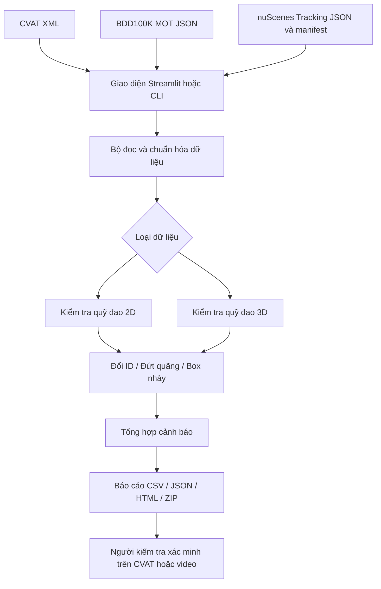

# 1. Sơ đồ kiến trúc — Tracking QA Tool

**Luồng xử lý:** nhập annotation → kiểm tra cấu trúc → gom đối tượng theo quỹ đạo → phân tích chuyển động → sinh cảnh báo → xuất báo cáo. Tệp gốc không bị sửa đổi.

**Công nghệ:** Python, NumPy, SciPy, Streamlit và pandas. Phân tích annotation không bắt buộc có GPU. Giao diện Streamlit gọi công cụ dòng lệnh và hiển thị kết quả.

**Lưu ý:** Dữ liệu nuScenes cần manifest chứa thứ tự frame và timestamp; dữ liệu 2D và 3D được xử lý bằng các phép kiểm tra khác nhau.
