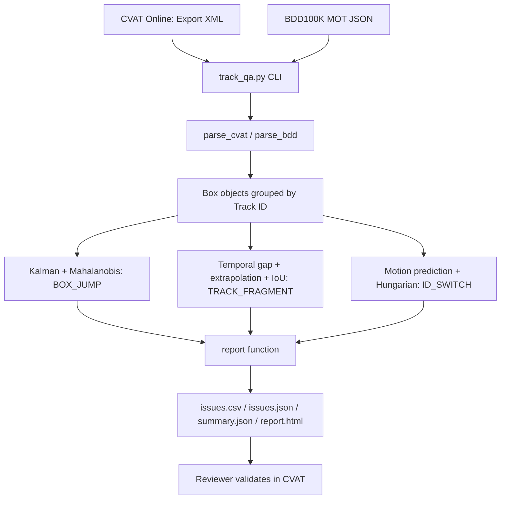

# 1. Architecture Diagram — Tracking QA

**Deployment:** Offline Python 3, NumPy and SciPy on Windows/Linux. No GPU, database, web server or CVAT API required.

**Data flow:** one video annotation → parse valid 2D boxes → group/sort by ID/frame → three independent detectors → flagged issues → CSV/JSON/HTML. The input file is never modified.

**Interfaces:** `python track_qa.py --input demo.xml --format cvat --output results` or `--format bdd` for per-video BDD100K MOT JSON.
